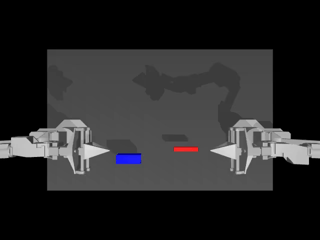

# ACTLearning

从零理解并复现 **ACT（Action Chunking with Transformers）**，最后在 ALOHA 仿真里亲眼看到训练出来的策略动起来。



> 上图：LeRobot 官方预训练 ACT 权重在 `gym_aloha/AlohaInsertion-v0` 中的一次成功 rollout（左臂夹住销钉，插入右侧插孔）。

## 这个仓库是什么

一个**教学型**仓库，核心是一份中文 notebook：不调用黑盒，而是把 ACT 拆开讲清楚，并用公开数据 + 公开仿真跑出可复现的结果。

它是：

- 一份从原理到部署的**中文教程**（原理 → 数据管线 → 从零实现 → 对齐官方实现 → 仿真验证 → 部署）
- 一套**可复现的基线**：数据、命令、指标都写清楚，换机器可以重跑

它不是：

- 论文级实现或 SOTA 复现（MiniACT 只用来验证管线）
- 一套能直接上真机的控制策略（部署章节只给骨架与安全检查清单）

## 你会看到什么

1. **为什么需要 action chunking**：行为克隆的误差累积、多模态演示为什么让 MSE 失效。
2. **数据管线**：LeRobot v3 数据集、观测/动作的归一化、chunk 与 episode 末尾 padding。
3. **从零实现 MiniACT**：约 1.4M 参数的 CNN + CVAE + Transformer，在真实规模的数据上训练与评估。
4. **对齐 LeRobot 官方 `ACTPolicy`**：配置项、forward、预处理/后处理、训练命令。
5. **仿真验证**：把策略放进 MuJoCo 的 ALOHA 环境里跑完整 episode，看成功率与 rollout 视频。
6. **部署与排错**：动作队列 vs 时序集成、控制循环骨架、推理延迟测量、常见现象速查。

## 目录结构

```
ACTLearning/
├── notebooks/
│   ├── ACT_tutorial.ipynb   # 主教程
│   ├── ACT_tutorial.html    # 导出物，不装环境也能读
│   └── assets/              # 示意图与 rollout 演示
├── data/                    # 数据集缓存（不入库，见下文）
└── outputs/                 # cache / checkpoint / 评测结果（不入库）
```

## 环境

Python 需要 **3.12**：LeRobot 要求 `>=3.12`，而 ALOHA 仿真依赖的 `dm_control → labmaze` 目前只提供到 `cp312` 的 wheel，所以 3.13 装不上。

```bash
conda create -n lerobot python=3.12 -y    # 环境名可自取；已有 Python 3.13 的同名环境时请另建（如 lerobot_act）
conda activate lerobot
pip install "lerobot[dataset,training,core-scripts,evaluation,av-dep,matplotlib-dep]"
pip install gym-aloha jupyterlab        # 仿真与交互式运行
```

国内网络可先设置镜像（可选）：

```bash
export HF_ENDPOINT=https://hf-mirror.com
export HF_HUB_DISABLE_XET=1
```

## 数据

使用 LeRobot 公开的 ALOHA 仿真插入数据集，首次运行会自动下载（约 90 MB）：

```
lerobot/aloha_sim_insertion_human   50 episodes / 25000 帧 / 50 fps
  observation.state   (14,)          双臂关节位置
  action              (14,)          关节目标
  observation.images.top  (3,480,640) 顶视相机
  task: "Insert the peg into the socket."
```

notebook 默认从 `data/aloha_sim_insertion_human` 读取；你也可以用环境变量 `ACT_DATASET_ROOT` 指向自己的副本。

## 快速开始

```bash
jupyter lab --ip 127.0.0.1 --port 8888 --no-browser
```

打开 `notebooks/ACT_tutorial.ipynb`，按顺序执行。只想读不想跑，看 `notebooks/ACT_tutorial.html`。

无界面全量执行（会重建缓存并训练，耗时且占用 GPU）：

```bash
jupyter nbconvert --to notebook --execute --inplace \
  --ExecutePreprocessor.timeout=-1 notebooks/ACT_tutorial.ipynb
```

## 在仿真里验证

**一、拿官方预训练权重直接看效果**（最快，几十秒一个 episode）：

```bash
# 旧格式 checkpoint 需要先迁移到新的 processor 格式
python -m lerobot.processor.migrate_policy_normalization \
  --pretrained-path lerobot/act_aloha_sim_insertion_human \
  --output-dir outputs/models/act_aloha_sim_insertion_human

MUJOCO_GL=egl lerobot-eval \
  --policy.path=outputs/models/act_aloha_sim_insertion_human \
  --env.type=aloha --policy.device=cuda \
  --eval.n_episodes=10 --eval.batch_size=1 \
  --output_dir=outputs/sim_eval/pretrained
```

每个 episode 的 rollout 视频会落在 `outputs/sim_eval/pretrained/videos/aloha_0/`，成功率写在 `eval_info.json` 的 `per_group.aloha.pc_success`。

**二、自己训练再看**：

```bash
lerobot-train \
  --dataset.repo_id=lerobot/aloha_sim_insertion_human \
  --policy.type=act --policy.device=cuda \
  --output_dir=outputs/train/act_aloha_sim \
  --batch_size=8 --steps=20000
```

训练完把 `--policy.path` 换成 `outputs/train/act_aloha_sim/checkpoints/last/pretrained_model` 再 eval。

headless 服务器记得 `export MUJOCO_GL=egl`（没有 GPU 时用 `osmesa`），否则 MuJoCo 起不来。

## 实测结果

在本机单卡（8 GB 显存）上复现的数字：

| 项目 | 设置 | 结果 |
|---|---|---|
| MiniACT（notebook 第 4 节） | 600 步，40 条训练 / 10 条验证，64×64 输入 | 验证集归一化 L1 **0.183**（repeat-state 0.206，zero 0.786） |
| 官方 `ACTPolicy` 短训练 | 900 步，dim_model=256，40 / 10 条 episode | 验证集归一化 L1 **0.244**，比 repeat-state 0.202 略差（远未收敛） |
| 官方预训练 ACT（仿真） | `AlohaInsertion-v0`，10 episodes，seed 1000–1009 | 成功率 **20%**（2/10），平均 `max_reward` 2.8 |
| 官方仓库记录（仿真） | 同一 checkpoint，500 episodes | 成功率 **83%**（415/500） |

仿真成功率的差距主要来自**仿真环境版本**（MuJoCo / gym-aloha 的行为与渲染差异），而不是权重迁移——迁移后的归一化统计量与数据集 `meta/stats.json` 完全一致。这一点本身就是教学价值：**报告成功率必须同时报告环境版本与 episode 数**。

上面的数字都来自 notebook 的一次完整执行（`--execute --inplace`），可在 `notebooks/ACT_tutorial.html` 里直接看到对应 cell 的输出。

## 说明

- 结论要可复现：notebook 里每个数字都能追溯到一条命令或一个 cell。
- 数据和权重不入库，`data/`、`outputs/` 已在 `.gitignore` 中。
- 文档只写可复现的结论与命令，不绑定具体主机名/路径；任何数字都会标注测量条件（环境版本、episode 数、步数）。

## 参考

- 论文：[Learning Fine-Grained Bimanual Manipulation with Low-Cost Hardware](https://arxiv.org/abs/2304.13705)
- 原实现：[tonyzhaozh/act](https://github.com/tonyzhaozh/act)
- LeRobot：[huggingface/lerobot](https://github.com/huggingface/lerobot)，策略实现见 `lerobot/policies/act/`
- 数据集：[lerobot/aloha_sim_insertion_human](https://huggingface.co/datasets/lerobot/aloha_sim_insertion_human)
- 预训练权重：[lerobot/act_aloha_sim_insertion_human](https://huggingface.co/lerobot/act_aloha_sim_insertion_human)
